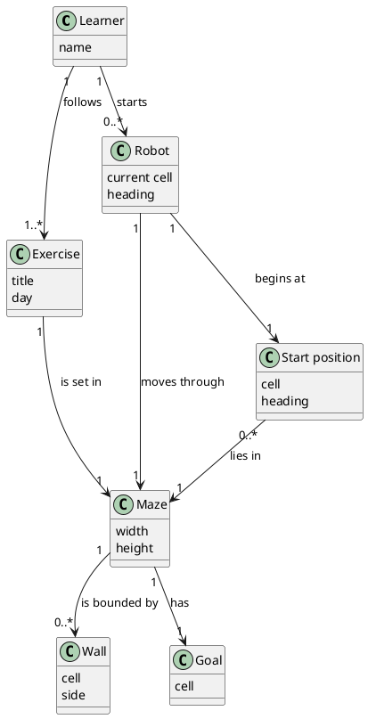

# Domain Model: Reeborg Maze

## Metadata
| Key | Value |
| --- | --- |
| ID | DM-001 |
| CrossReference | [UC-001], [UCD-001], [SSD-001], [DICT-001] |
| Language | en |
| Domain | education |

## Version History
| Date | Status | Author | Reviewer | Change | Commit |
| --- | --- | --- | --- | --- | --- |
| 2026-11-15 | Accepted | Jens Tirsvad Nielsen | AI as stand-in for S02 | Initial version; reviewed in RC-015, autonomous, not independent | [f9581e1] |

---

## Purpose and Scope

Covers: [UC-001] Solve the maze. The model shows the learner's world of the exercise. It answers concern CN-001 of [SA-001] (the robot reaches the goal from every start) and serves S01 and S05, the learners who read it. The project has one use case, so this is also the project Domain Model.

## Diagram

Concepts, attributes and associations only — no operations.

The diagram was not rendered on a PlantUML server because the registry names none; it was checked by reading.

## Concept Table

| Concept | Definition | Attributes | Source (use case / glossary) |
| --- | --- | --- | --- |
| Learner | The person who follows the course and starts the robot | name | UC-001, [DICT-001] |
| Exercise | The task from the course that the learner must solve, here the maze of day 6 | title, day | UC-001, [DICT-001] |
| Maze | The fixed set of walls through which the robot must find its way | width, height | UC-001, [DICT-001] |
| Wall | A barrier between two cells that the robot cannot pass | cell, side | UC-001, [DICT-001] |
| Goal | The place in the maze where the robot has finished its exercise | cell | UC-001, [DICT-001] |
| Robot | The figure that the learner's program moves through the maze | current cell, heading | UC-001, [DICT-001] |
| Start position | The random cell and heading from which the robot starts | cell, heading | UC-001, [DICT-001] |

## Association Table

| From | Association (reading direction) | To | Multiplicity |
| --- | --- | --- | --- |
| Learner | follows | Exercise | 1 to 1..* |
| Exercise | is set in | Maze | 1 to 1 |
| Maze | is bounded by | Wall | 1 to 0..* |
| Maze | has | Goal | 1 to 1 |
| Learner | starts | Robot | 1 to 0..* |
| Robot | moves through | Maze | 1 to 1 |
| Robot | begins at | Start position | 1 to 1 |
| Start position | lies in | Maze | 0..* to 1 |

## Generalizations

| General | Specializations | Is-a justification |
| --- | --- | --- |
| none | none | No concept is a kind of another |

---
[UC-001]: ./use-cases/uc-001/uc.md
[UCD-001]: ./use-case-diagram.md
[DICT-001]: ./dictionary.md
[SSD-001]: ./use-cases/uc-001/ssd.md
[f9581e1]: https://git.tirsystem.com/Tirsvad-Udemy-100-days-of-code/006-a-robot-in-reeborg-s-world/commit/f9581e128ebea2e751df0bb20267a94301763f4b
