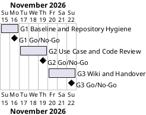

# Project Plan: Reeborg Maze

## Metadata
| Key | Value |
| --- | --- |
| ID | PP-001 |
| CrossReference | [BC-001], [SA-001], [MIL-001], [MIL-002], [MIL-003] |
| Language | en |
| Domain | education |

## Version History
| Date | Status | Author | Reviewer | Change | Commit |
| --- | --- | --- | --- | --- | --- |
| 2026-11-15 | Accepted | Jens Tirsvad Nielsen | S01 (Product Owner) | Initial version; reviewed in RC-003, autonomous, not independent | [422cb5e] |

---

## Purpose

This plan schedules the three gateways of the Reeborg Maze project over the Business Case constraint: a prototype delivered between 2026-11-15 and 2026-11-22. It lists each gateway with its document, owner and decision date. The tasks of each gateway are in its milestone document, not here.

## Planning Assumptions

- The plan starts on 2026-11-15 and ends on 2026-11-22, as the constraints of [BC-001] state.
- Each gateway takes two to three days. The project has one developer (S01) and one reviewer role (S02), which the AI fills as stand-in in autonomous mode, so there is no cadence of meetings; S01 hears from the run through the end-of-run summary ([SA-001], CM-1).
- The Product Owner is S01 and accepts this plan, as the plan has no checklist.
- The three dates are targets chosen by the AI inside the Business Case window; S01 may move them when accepting the plan.
- The repository is public, so the prompt log is not committed.
- Milestones and issues are published to the git host with `sync-project.sh --apply` once S01 has accepted the plan, because the project has no publish workflow.

## Gateway Schedule

| Gateway | Document | Window | Decision date | Owner | Stories | Main deliverable | Milestone |
| --- | --- | --- | --- | --- | --- | --- | --- |
| G1 Baseline and Repository Hygiene | [MIL-001] | 2026-11-15 to 2026-11-16 | 2026-11-16 | S01 | none (documents and repository tasks) | The accepted baseline: Business Case, Stakeholder Analysis, Project Plan, milestones, dictionary, governance, traceability matrix and the ADR; tracked mounts, licence metadata and README [Milestone](https://git.tirsystem.com/Tirsvad-Udemy-100-days-of-code/006-a-robot-in-reeborg-s-world/milestones/502) |
| G2 Use Case and Code Review | [MIL-002] | 2026-11-17 to 2026-11-19 | 2026-11-19 | S01 | US-001 | The accepted use case, domain model and system sequence diagram; a `Go` code review; the script-equivalence test [Milestone](https://git.tirsystem.com/Tirsvad-Udemy-100-days-of-code/006-a-robot-in-reeborg-s-world/milestones/503) |
| G3 Wiki and Handover | [MIL-003] | 2026-11-20 to 2026-11-22 | 2026-11-22 | S01 | none (documentation tasks) | The published wiki in English, Danish and Malay, the final README, the traceability matrix and the end-of-run summary [Milestone](https://git.tirsystem.com/Tirsvad-Udemy-100-days-of-code/006-a-robot-in-reeborg-s-world/milestones/504) |



## Scope Coverage

| Business Case scope item | Gateway |
| --- | --- |
| Solver, Reeborg script, simulator and visualiser (existing code) | G2 (code review and script-equivalence test) |
| Tests on the three provided worlds (existing tests) | G2 |
| Baseline documents, dictionary, governance, traceability matrix | G1 |
| The single use case with its story, diagram, domain model and system sequence diagram | G2 |
| README and package metadata, including the licence | G1 (README, metadata) and G3 (final links) |
| The wiki in English, Danish and Malay | G3 |
| Tracking `.gitmodules` and `.env.example` | G1 |

## Dependencies

```
G1 Baseline and Repository Hygiene → G2 Use Case and Code Review → G3 Wiki and Handover
```

A No-Go at a gateway returns that gateway's work for rework and moves every later gateway by the same number of days. The end date of 2026-11-22 moves only when S01 decides it, because S01 is the Accountable role for the schedule in the governance RACI.

## Plan Risks

| Risk | Impact | Mitigation |
| --- | --- | --- |
| A language review by a person is not available for criteria 3, 5 and 9 of `QC-LANG-001` | Rows stay `Proposed` after a `Go-with-conditions`, so a later gateway cannot start (BC-001 risk on language review) | S01 confirms those criteria in chat; if not, the run stops and reports |
| The git host token is missing when the milestones are published | Issues cannot be created, so a pull request has no number to close | Documents and code do not depend on the issues; the pull request says that the issues close after publication |
| The published wiki cannot be checked until after the merge of G3 | The wiki review waits for the merge (BC-001 risk on stand-in reviews) | Task 5 of G3 verifies the wiki after the merge and records the review in a short follow-up pull request |

## Open Issues

- The PlantUML server in `docs/artifact-registry.md` is not set; the Gantt chart is checked by reading until S01 names a trusted server.
- S02 has no named person; the AI stands in for it in autonomous mode.
- The dates of the three gateways are targets and may be moved when the plan is accepted.

---

[BC-001]: ./business-case.md
[SA-001]: ./stakeholder-analysis.md
[MIL-001]: ./milestones/mil-001-baseline.md
[MIL-002]: ./milestones/mil-002-use-case-and-code.md
[MIL-003]: ./milestones/mil-003-wiki-and-handover.md
[422cb5e]: https://git.tirsystem.com/Tirsvad-Udemy-100-days-of-code/006-a-robot-in-reeborg-s-world/commit/422cb5ea48b5e16adbc3ad74902614f5de08c22a
