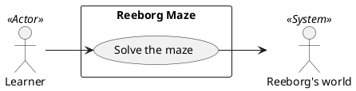

# Use Case Diagram: Reeborg Maze

## Metadata
| Key | Value |
| --- | --- |
| ID | UCD-001 |
| CrossReference | [SA-001], [BC-001], [US-001], [UC-001] |
| Language | en |
| Domain | education |

## Version History
| Date | Status | Author | Reviewer | Change | Commit |
| --- | --- | --- | --- | --- | --- |
| 2026-11-15 | Accepted | Jens Tirsvad Nielsen | AI as stand-in for S02 | Initial version; reviewed in RC-013, autonomous, not independent | [f9581e1] |

---

## Purpose and Scope

MoSCoW stands for Must, Should, Could, Won't now, the priority scheme used in the use case table. The system boundary is the Reeborg Maze solution: the program that the learner (S01) writes for the day 6 exercise of the course, which moves the robot through the maze to the goal. The boundary holds one goal of the learner. Reeborg's world, the website that animates the robot, lies outside the boundary and is a supporting actor. The diagram answers the need of S01 to pass the exercise (CN-001 in [SA-001]) and serves objective O1 of [BC-001].

## Diagram

Crossings of the chosen layout: 0. The diagram has one use case, so no other layout was tried. It was not rendered on a PlantUML server because the registry names none; it was checked by reading.

## Actor Table

| Actor | Stereotype | Stakeholder ID (SA) | Goals (use cases) |
| --- | --- | --- | --- |
| Learner | `<<Actor>>` | S01 | Solve the maze |
| Reeborg's world | `<<System>>` | S04 | Solve the maze (supports it by animating the robot) |

## Use Case Table

| Use Case | Actor(s) | Goal | Source story | Priority (MoSCoW) | Reason |
| --- | --- | --- | --- | --- | --- |
| Solve the maze | Learner, Reeborg's world | The robot reaches the goal from any start position | US-001.01, US-001.02 | Must | It is the whole exercise and carries objectives O1 and O2 of [BC-001] |

## Role Matrix

Not applicable: the project has one primary actor, the learner, so no roles are suggested.

## Relationships

| From | Relationship (`<<include>>` / `<<extend>>`) | To | Justification |
| --- | --- | --- | --- |
| none | none | none | The single use case includes and extends no other use case |

---
[SA-001]: ./stakeholder-analysis.md
[BC-001]: ./business-case.md
[US-001]: ./user-stories.md
[UC-001]: ./use-cases/uc-001/uc.md
[f9581e1]: https://git.tirsystem.com/Tirsvad-Udemy-100-days-of-code/006-a-robot-in-reeborg-s-world/commit/f9581e128ebea2e751df0bb20267a94301763f4b
