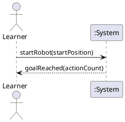

# SSD for UC-001 Solve the maze

## Metadata
| Key | Value |
| --- | --- |
| ID | SSD-001 |
| CrossReference | [UC-001], [DM-001] |
| Language | en |
| Domain | education |

## Version History
| Date | Status | Author | Reviewer | Change | Commit |
| --- | --- | --- | --- | --- | --- |
| 2026-11-15 | Accepted | Jens Tirsvad Nielsen | AI as stand-in for S02 | Initial version; reviewed in RC-016, autonomous, not independent | pending |

---

## Source Use Case

Solve the maze ([UC-001]) — scenario: main success scenario

## Diagram

The diagram was not rendered on a PlantUML server because the registry names none; it was checked by reading.

## System Operations

| Step | Message | Parameters | Return | Use case step |
| --- | --- | --- | --- | --- |
| 1 | startRobot | startPosition (cell and heading; in the offline run it can be given, in Reeborg's world it is random) | goalReached with the number of actions the robot took | The learner starts the robot; the robot follows the wall and stops on the goal |

## Lifecycle Notes

- Alternate flow: the system treats a maze with no reachable goal as out of scope, as [UC-001] says; no separate diagram is drawn for it.
- The robot's single moves and turns are inside the system and do not appear on this diagram (the system is a black box).
- The system instance exists for one run; there is nothing to create or destroy explicitly.

---
[UC-001]: ./uc.md
[DM-001]: ../../domain-model.md
